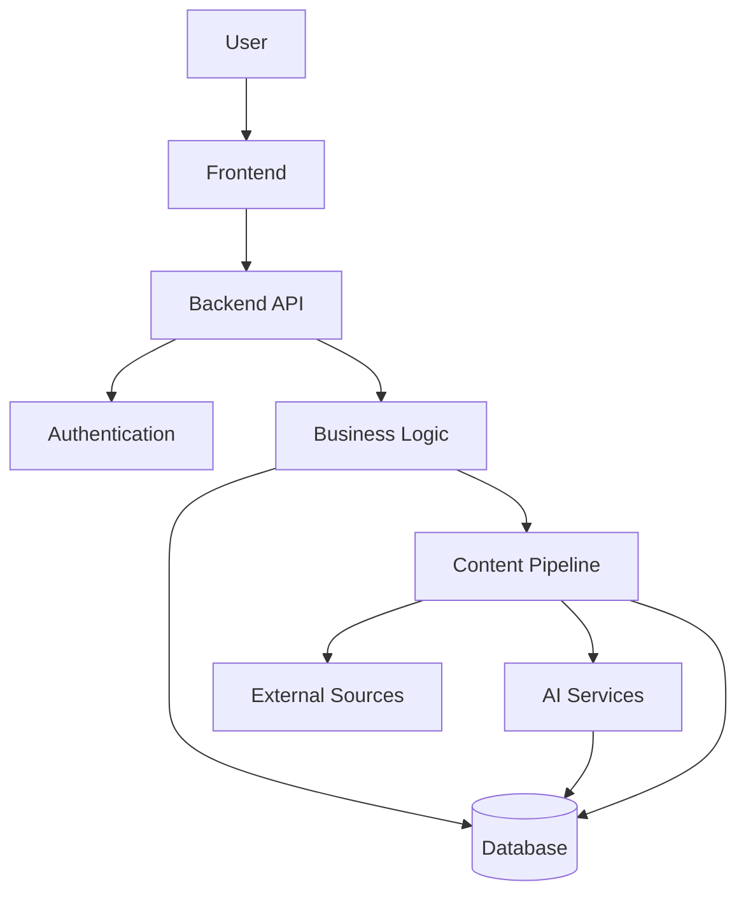
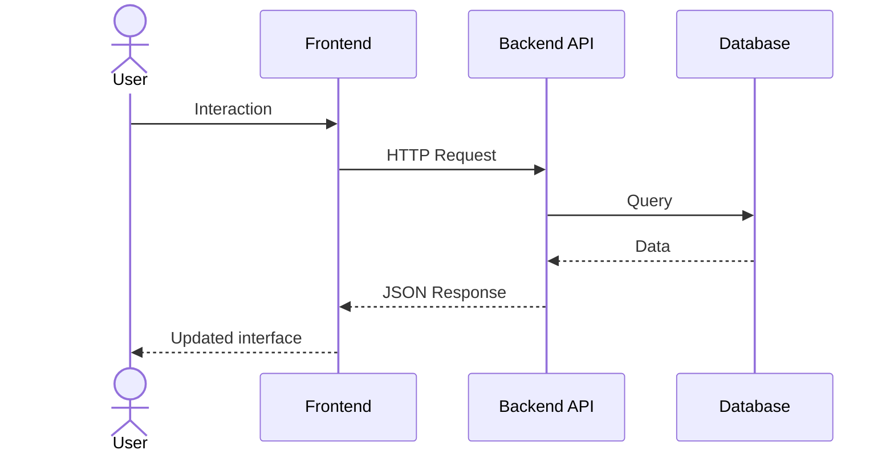
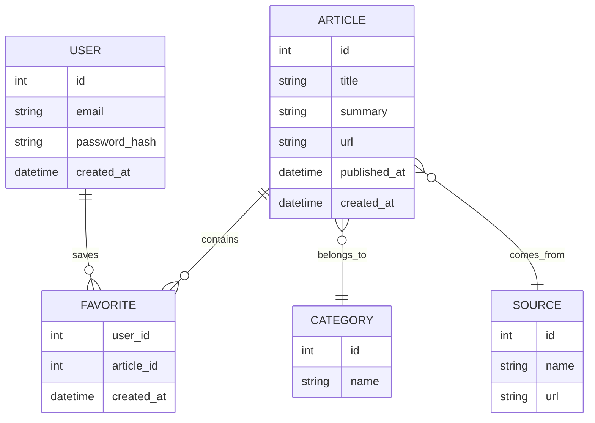
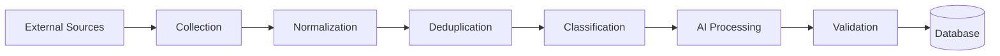
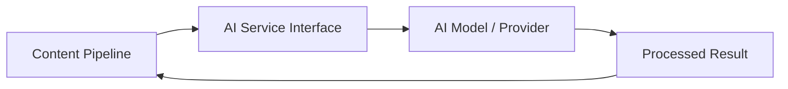
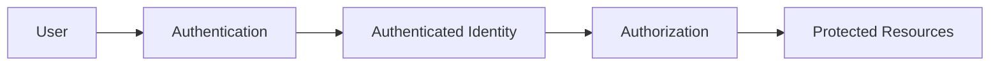
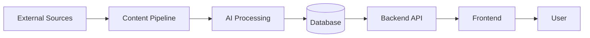
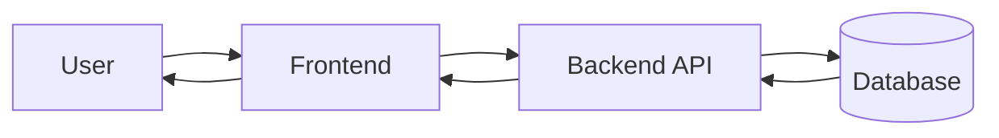
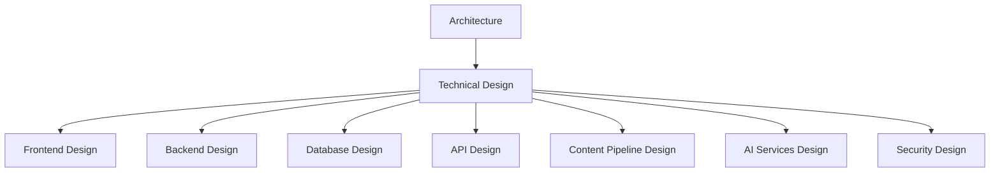

# AI Daily — Technical Design

## 1. Overview

This document describes the technical design of AI Daily.

While the architecture document defines the major components and their relationships, this document goes one level deeper and describes how those components are expected to be implemented.

The technical design focuses on:

- Frontend structure
- Backend structure
- API design
- Database design
- Content processing
- AI services
- Authentication
- Error handling
- Configuration
- Testing
- Technology decisions

The design is intentionally modular so that individual technologies can evolve without requiring a complete redesign of the system.

---

## 2. System Design

AI Daily is designed as a modular web application composed of several technical layers.



The main principle is separation of responsibilities.

Each component should have a clearly defined responsibility and communicate with other components through explicit interfaces.

---

## 3. Frontend Design

The frontend is responsible for presenting AI Daily to users and handling user interactions.

### Main responsibilities

- Display AI news
- Display categories
- Provide search
- Display article details
- Manage user interactions
- Manage authentication state
- Handle saved content
- Communicate with the backend API
- Provide a responsive and installable PWA experience

### Initial structure

The frontend can initially be organized around the following concepts:

```text
Frontend
├── Pages
├── Components
├── Services
├── State
├── Utilities
└── Assets
```

The exact framework and structure may evolve as the project develops.

### Frontend communication

The frontend should communicate with the backend through the API rather than accessing the database directly.



---

## 4. Backend Design

The backend provides the main application logic and API.

The backend is responsible for:

- Request handling
- Authentication
- Authorization
- Business logic
- Content retrieval
- User preferences
- Search operations
- Database communication
- Integration with external services

The backend should be organized into logical modules rather than placing all logic in a single application layer.

A possible structure is:

```text
Backend
├── API
├── Auth
├── Models
├── Services
├── Repositories
├── Schemas
├── Configuration
└── Utilities
```

The exact implementation may evolve as requirements become clearer.

---

## 5. API Design

The backend exposes an API used by the frontend and potentially other clients in the future.

The API should follow clear conventions for:

- Resource naming
- HTTP methods
- Status codes
- Request validation
- Response formats
- Authentication
- Error responses

Example resources include:

| Resource       | Purpose                           |
| -------------- | --------------------------------- |
| `/articles`    | Retrieve and manage news articles |
| `/categories`  | Retrieve available categories     |
| `/search`      | Search content                    |
| `/users`       | Manage user information           |
| `/preferences` | Manage user preferences           |
| `/favorites`   | Manage saved articles             |

These endpoints are examples of the intended API structure and may change during implementation.

In the first implementation, `GET /articles` accepts `offset` and `limit` to page through the feed. The API returns 20 articles by default and limits a request to 50 articles.

### API principle

The API should remain independent from the frontend implementation.

This allows AI Daily to eventually support:

- Web clients
- Mobile clients
- PWA clients
- External integrations

---

## 6. Database Design

The database stores persistent application data.

Initial entities may include:

- Users
- Articles
- Categories
- Sources
- Favorites
- User preferences

A simplified relationship model can be represented as:



The database schema will evolve as new requirements are introduced.

The design should prioritize data consistency, clear relationships, and maintainability.

---

## 7. Content Pipeline Design

The content pipeline is responsible for automatically collecting and processing AI-related information.

The pipeline can be divided into several stages:

The diagram below describes the target pipeline. For the MVP, only collection from selected RSS feeds, extraction of the main metadata, and storage with the original link are planned. Advanced deduplication, automatic categorization, and AI processing belong to Phase 3 of the roadmap.



### Collection

The system retrieves content from supported external sources.

Possible sources include:

- RSS feeds selected for the MVP.
- APIs and other structured sources in later phases, depending on availability and project needs.
- Websites only when collection can be supported appropriately.

The first RSS source selected for the MVP is OpenAI News: `https://openai.com/news/rss.xml`. The backend converts feed entries into AI Daily's common article format. Additional sources will be added progressively.

### Normalization

Collected content is transformed into a common internal format.

For example:

```text
Source-specific format
        ↓
Common Article format
```

### Deduplication

The system detects duplicate or highly similar articles.

This prevents the same information from appearing multiple times.

### Classification

Articles can be classified according to predefined categories.

Examples:

- Artificial Intelligence
- Machine Learning
- Generative AI
- Robotics
- Research
- Companies
- Open Source

### AI Processing

AI services may be used for:

- Summarization
- Classification
- Keyword extraction
- Topic detection
- Recommendation support

### Validation

Processed content should pass basic quality checks before being stored and displayed.

---

## 8. AI Services Design

AI services are treated as independent components rather than being deeply coupled to the rest of the application.

This allows the project to change AI providers or models without redesigning the entire system.

A simplified abstraction is:



The system should ideally interact with an abstraction rather than directly depending on one specific AI provider.

Possible AI operations include:

| Operation      | Purpose                                |
| -------------- | -------------------------------------- |
| Summarization  | Produce concise article summaries      |
| Classification | Assign categories                      |
| Extraction     | Identify keywords and entities         |
| Recommendation | Support personalized content discovery |

AI-generated results should be treated as processed data and should not automatically be considered authoritative.

---

## 9. Authentication and Authorization

Authentication allows users to identify themselves.

Authorization determines which resources and operations a user is allowed to access.

The system should separate these two concepts.



Examples of protected operations include:

- Managing personal preferences
- Saving articles
- Accessing personal data
- Modifying account information

Security mechanisms will be selected and documented in greater detail during implementation.

---

## 10. Data Flow

The main data flows through AI Daily can be divided into two categories:

### Content flow



### User interaction flow



---

## 11. Error Handling

The system should handle errors at each major layer.

Examples include:

- Invalid user input
- Authentication failures
- Database failures
- Network failures
- External API failures
- Content processing failures
- AI service failures

Errors should be:

1. Detected
2. Logged appropriately
3. Converted into meaningful responses
4. Presented to the user when necessary

Internal technical details should not be exposed to users.

For example, an internal database error should not result in a raw database error being displayed in the frontend.

---

## 12. Configuration Management

Configuration should be separated from application logic.

Sensitive values should not be stored directly in source code.

Examples include:

- Database credentials
- API keys
- Authentication secrets
- AI provider credentials
- External service configuration

Environment variables can be used to manage environment-specific configuration.

Example:

```text
Development
    ↓
Environment variables
    ↓
Application configuration
    ↓
Application components
```

Different environments should be able to use different configurations without modifying the application code.

---

## 13. Testing Strategy

Testing should progressively be introduced as the project becomes more complex.

The initial strategy can include:

| Test Type         | Purpose                               |
| ----------------- | ------------------------------------- |
| Unit Tests        | Test individual functions and modules |
| Integration Tests | Test interactions between components  |
| API Tests         | Validate API behavior                 |
| Database Tests    | Validate data operations              |
| End-to-End Tests  | Validate complete user workflows      |

Testing should focus first on critical application logic.

Examples include:

- Authentication
- Article processing
- API endpoints
- Database operations
- Content deduplication

---

## 14. Technology Decisions

The initial technical direction is based on technologies that support the project's learning objectives while remaining suitable for future evolution.

| Area            | Initial Direction             |
| --------------- | ----------------------------- |
| Frontend        | HTML / CSS / JavaScript       |
| Backend         | Python / FastAPI              |
| Database        | Relational database           |
| API             | HTTP / REST-style API         |
| AI              | External or local AI services |
| Version Control | Git / GitHub                  |
| Deployment      | Cloud-based deployment        |
| Documentation   | Markdown / Mermaid            |

These choices are not considered permanently fixed.

Technology decisions may be revisited when project requirements, performance constraints, or learning objectives change.

---

## 15. Future Considerations

The technical design should allow future capabilities such as:

- Advanced search
- Personalized recommendations
- Notifications
- Offline PWA support
- Background processing
- More AI-powered features
- Additional content sources
- Mobile clients
- Analytics
- Improved observability
- Horizontal scaling

These features should be introduced only when they provide a clear benefit to the project.

---

## 16. Relationship with Architecture

The relationship between architecture and technical design can be summarized as follows:



The architecture defines **what the major components are and how they interact**.

The technical design defines **how those components are expected to be implemented**.

---

## 17. Current Status

The technical design establishes the initial implementation direction for AI Daily.

It is intentionally flexible and will evolve as development progresses.

The next step is to transform these technical concepts into concrete implementation structures, beginning with the project foundation and the first MVP components.
