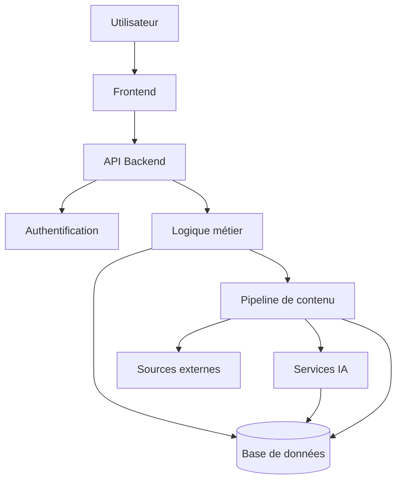
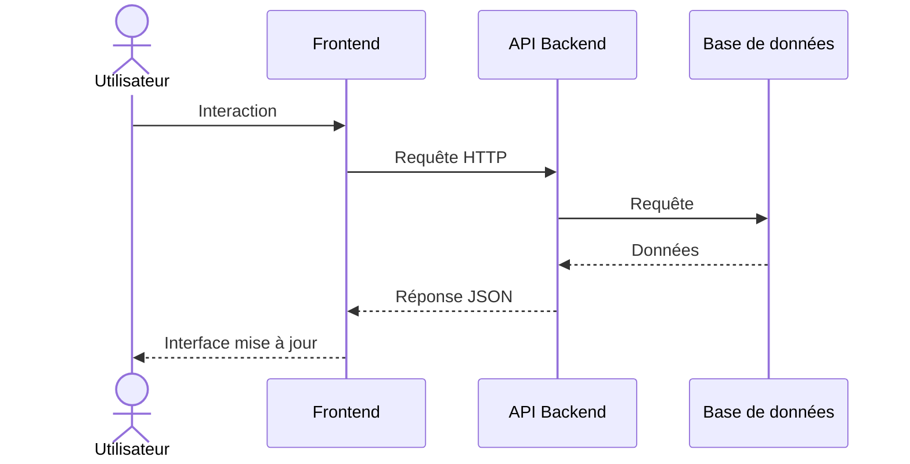
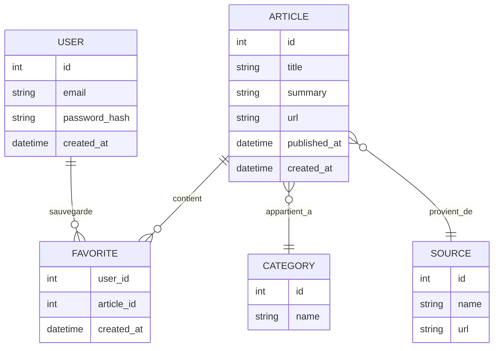
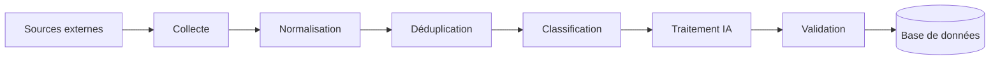
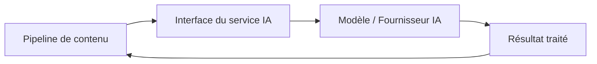
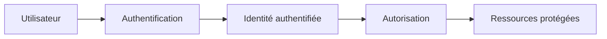
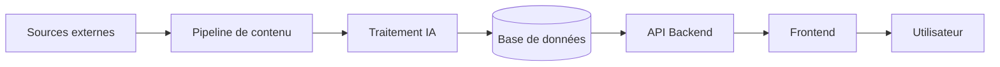
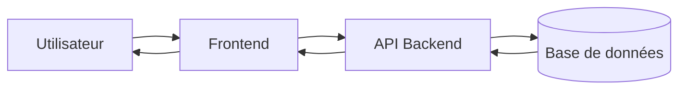
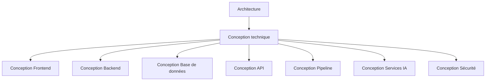

# AI Daily — Conception technique

## 1. Vue d’ensemble

Ce document décrit la conception technique de AI Daily.

Alors que le document d’architecture définit les principaux composants du système et leurs relations, ce document descend d’un niveau supplémentaire et décrit la manière dont ces composants sont destinés à être implémentés.

La conception technique couvre notamment :

- La structure du frontend
- La structure du backend
- La conception de l’API
- La conception de la base de données
- Le traitement du contenu
- Les services IA
- L’authentification
- La gestion des erreurs
- La configuration
- La stratégie de tests
- Les choix technologiques

La conception reste volontairement modulaire afin que certaines technologies puissent évoluer sans nécessiter une refonte complète du système.

---

## 2. Conception du système

AI Daily est conçu comme une application web modulaire composée de plusieurs couches techniques.



Le principe principal est la séparation des responsabilités.

Chaque composant doit avoir une responsabilité clairement définie et communiquer avec les autres composants à travers des interfaces explicites.

---

## 3. Conception du frontend

Le frontend est responsable de présenter AI Daily aux utilisateurs et de gérer leurs interactions avec l’application.

### Responsabilités principales

- Afficher les actualités IA
- Afficher les catégories
- Fournir la recherche
- Afficher les détails des articles
- Gérer les interactions utilisateur
- Gérer l’état d’authentification
- Gérer les contenus enregistrés
- Communiquer avec l’API backend
- Fournir une expérience PWA responsive et installable

### Structure initiale

Le frontend peut initialement être organisé autour des éléments suivants :

```text
Frontend
├── Pages
├── Components
├── Services
├── State
├── Utilities
└── Assets
```

La structure exacte pourra évoluer avec le développement du projet.

### Communication avec le backend

Le frontend doit communiquer avec le backend à travers l’API et ne doit pas accéder directement à la base de données.



---

## 4. Conception du backend

Le backend fournit la logique principale de l’application ainsi que l’API.

Le backend est notamment responsable de :

- La gestion des requêtes
- L’authentification
- L’autorisation
- La logique métier
- La récupération des contenus
- Les préférences utilisateur
- Les opérations de recherche
- La communication avec la base de données
- L’intégration avec les services externes

Le backend doit être organisé en modules logiques plutôt que de concentrer toute la logique dans une seule couche.

Une structure possible est :

```text
Backend
├── API
├── Auth
├── Models
├── Services
├── Repositories
├── Schemas
├── Configuration
└── Utilities
```

La structure exacte pourra évoluer lorsque les besoins deviendront plus précis.

---

## 5. Conception de l’API

Le backend expose une API utilisée par le frontend et potentiellement par d’autres clients dans le futur.

L’API doit suivre des conventions claires concernant :

- Le nommage des ressources
- Les méthodes HTTP
- Les codes de statut
- La validation des requêtes
- Le format des réponses
- L’authentification
- Les réponses d’erreur

Exemples de ressources :

| Ressource      | Utilisation                          |
| -------------- | ------------------------------------ |
| `/articles`    | Récupérer et gérer les articles      |
| `/categories`  | Récupérer les catégories disponibles |
| `/search`      | Rechercher du contenu                |
| `/users`       | Gérer les informations utilisateur   |
| `/preferences` | Gérer les préférences utilisateur    |
| `/favorites`   | Gérer les articles enregistrés       |

Ces endpoints représentent une direction initiale et pourront évoluer pendant l’implémentation.

Dans la première version, `GET /articles` accepte `offset` et `limit` pour parcourir le flux par pages. Par défaut, l’API renvoie 20 articles et limite une demande à 50 articles.

### Principe de l’API

L’API doit rester indépendante de l’implémentation du frontend.

Cela permettra éventuellement à AI Daily de prendre en charge :

- Des clients web
- Des clients mobiles
- La PWA
- Des intégrations externes

---

## 6. Conception de la base de données

La base de données stocke les données persistantes de l’application.

Les premières entités peuvent inclure :

- Utilisateurs
- Articles
- Catégories
- Sources
- Favoris
- Préférences utilisateur

Un modèle simplifié des relations peut être représenté ainsi :



Le schéma de la base de données évoluera avec l’introduction de nouvelles exigences.

La conception doit privilégier la cohérence des données, des relations claires et une bonne maintenabilité.

---

## 7. Conception du pipeline de contenu

Le pipeline de contenu est responsable de collecter et de traiter automatiquement les informations liées à l’IA.

Le pipeline peut être divisé en plusieurs étapes :

Le diagramme ci-dessous décrit le pipeline cible. Dans le MVP, seules la collecte depuis les flux RSS sélectionnés, l'extraction des métadonnées principales et leur enregistrement avec le lien original sont prévues. La déduplication avancée, la catégorisation automatique et le traitement par IA relèvent de la phase 3 de la feuille de route.



### Collecte

Le système récupère les contenus provenant de sources externes prises en charge.

Les sources peuvent notamment inclure :

- Flux RSS sélectionnés pour le MVP.
- APIs et autres sources structurées dans les phases ultérieures, selon leur disponibilité et les besoins du projet.
- Sites web uniquement lorsque leur collecte est prise en charge de manière appropriée.

La première source RSS retenue pour le MVP est OpenAI News : `https://openai.com/news/rss.xml`. Le backend convertit les entrées du flux vers le format commun d’article d’AI Daily. D’autres sources seront ajoutées progressivement.

### Normalisation

Les contenus récupérés sont transformés vers un format interne commun.

Par exemple :

```text
Format spécifique à une source
        ↓
Format Article commun
```

### Déduplication

Le système détecte les articles identiques ou fortement similaires.

Cela permet d’éviter qu’une même information apparaisse plusieurs fois.

### Classification

Les articles peuvent être classifiés selon des catégories prédéfinies.

Exemples :

- Intelligence artificielle
- Machine Learning
- IA générative
- Robotique
- Recherche
- Entreprises
- Open Source

### Traitement IA

Les services IA peuvent être utilisés pour :

- Le résumé
- La classification
- L’extraction de mots-clés
- La détection de sujets
- L’aide à la recommandation

### Validation

Les contenus traités doivent passer des contrôles de qualité de base avant d’être stockés et affichés.

---

## 8. Conception des services IA

Les services IA sont traités comme des composants indépendants plutôt que d’être fortement couplés au reste de l’application.

Cela permet de changer de fournisseur ou de modèle IA sans devoir reconcevoir l’ensemble du système.

Une abstraction simplifiée peut être représentée ainsi :



Le système devrait idéalement communiquer avec une abstraction plutôt que dépendre directement d’un fournisseur IA spécifique.

Les opérations IA possibles comprennent :

| Opération      | Utilisation                           |
| -------------- | ------------------------------------- |
| Résumé         | Produire des résumés concis           |
| Classification | Attribuer des catégories              |
| Extraction     | Identifier les mots-clés et entités   |
| Recommandation | Faciliter la découverte personnalisée |

Les résultats générés par l’IA doivent être considérés comme des données traitées et non automatiquement comme des informations faisant autorité.

---

## 9. Authentification et autorisation

L’authentification permet d’identifier un utilisateur.

L’autorisation détermine les ressources et opérations auxquelles cet utilisateur peut accéder.

Ces deux concepts doivent être séparés.



Les opérations protégées peuvent notamment inclure :

- La gestion des préférences personnelles
- L’enregistrement d’articles
- L’accès aux données personnelles
- La modification des informations du compte

Les mécanismes de sécurité seront définis plus précisément pendant l’implémentation.

---

## 10. Flux de données

Les principaux flux de données d’AI Daily peuvent être divisés en deux catégories.

### Flux de contenu



### Flux d’interaction utilisateur



---

## 11. Gestion des erreurs

Le système doit gérer les erreurs à chaque couche importante.

Exemples :

- Entrées utilisateur invalides
- Échecs d’authentification
- Erreurs de base de données
- Erreurs réseau
- Erreurs d’API externes
- Échecs du traitement des contenus
- Échecs des services IA

Les erreurs doivent être :

1. Détectées
2. Journalisées de manière appropriée
3. Transformées en réponses compréhensibles
4. Présentées à l’utilisateur lorsque cela est nécessaire

Les détails techniques internes ne doivent pas être exposés aux utilisateurs.

Par exemple, une erreur interne de base de données ne doit pas provoquer l’affichage d’un message technique brut dans le frontend.

---

## 12. Gestion de la configuration

La configuration doit être séparée de la logique de l’application.

Les informations sensibles ne doivent pas être directement enregistrées dans le code source.

Exemples :

- Identifiants de base de données
- Clés API
- Secrets d’authentification
- Identifiants des fournisseurs IA
- Configuration des services externes

Les variables d’environnement peuvent être utilisées pour gérer les configurations propres à chaque environnement.

```text
Développement
    ↓
Variables d’environnement
    ↓
Configuration de l’application
    ↓
Composants de l’application
```

Les différents environnements doivent pouvoir utiliser des configurations différentes sans modifier le code de l’application.

---

## 13. Stratégie de tests

Les tests doivent être introduits progressivement à mesure que le projet devient plus complexe.

La stratégie initiale peut inclure :

| Type de test             | Objectif                                    |
| ------------------------ | ------------------------------------------- |
| Tests unitaires          | Tester les fonctions et modules individuels |
| Tests d’intégration      | Tester les interactions entre composants    |
| Tests API                | Vérifier le comportement de l’API           |
| Tests de base de données | Vérifier les opérations sur les données     |
| Tests End-to-End         | Vérifier les parcours utilisateur complets  |

Les tests doivent d’abord se concentrer sur les éléments critiques de l’application.

Exemples :

- Authentification
- Traitement des articles
- Endpoints API
- Opérations de base de données
- Déduplication des contenus

---

## 14. Choix technologiques

La direction technique initiale repose sur des technologies adaptées aux objectifs d’apprentissage du projet tout en restant suffisamment flexibles pour son évolution future.

| Domaine             | Direction initiale             |
| ------------------- | ------------------------------ |
| Frontend            | HTML / CSS / JavaScript        |
| Backend             | Python / FastAPI               |
| Base de données     | Base de données relationnelle  |
| API                 | HTTP / API de style REST       |
| IA                  | Services IA externes ou locaux |
| Contrôle de version | Git / GitHub                   |
| Déploiement         | Déploiement cloud              |
| Documentation       | Markdown / Mermaid             |

Ces choix ne sont pas considérés comme définitifs.

Ils pourront être réévalués lorsque les exigences, les contraintes de performance ou les objectifs d’apprentissage évolueront.

---

## 15. Évolutions futures

La conception technique doit permettre l’ajout futur de fonctionnalités telles que :

- Recherche avancée
- Recommandations personnalisées
- Notifications
- Support hors ligne de la PWA
- Traitement en arrière-plan
- Fonctionnalités avancées basées sur l’IA
- Sources de contenu supplémentaires
- Clients mobiles
- Analytics
- Meilleure observabilité
- Scalabilité horizontale

Ces fonctionnalités ne doivent être introduites que lorsqu’elles apportent une réelle valeur au projet.

---

## 16. Relation avec l’architecture

La relation entre l’architecture et la conception technique peut être résumée ainsi :



L’architecture définit **quels sont les principaux composants et comment ils interagissent**.

La conception technique définit **comment ces composants sont destinés à être implémentés**.

---

## 17. État actuel

La conception technique établit la première direction d’implémentation de AI Daily.

Elle reste volontairement flexible et évoluera avec le développement du projet.

La prochaine étape consiste à transformer ces concepts techniques en structures concrètes d’implémentation, en commençant par les fondations du projet et les premiers composants du MVP.
